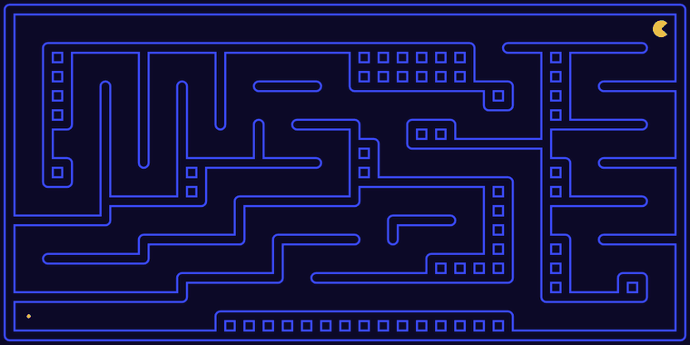
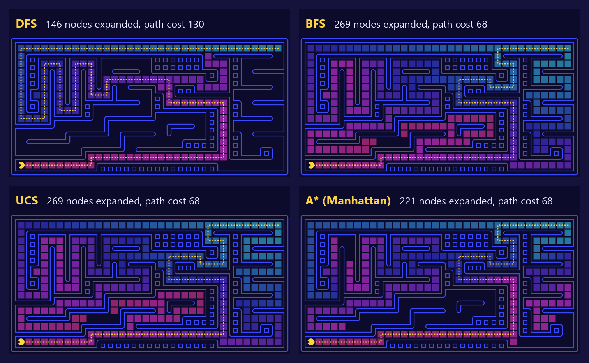
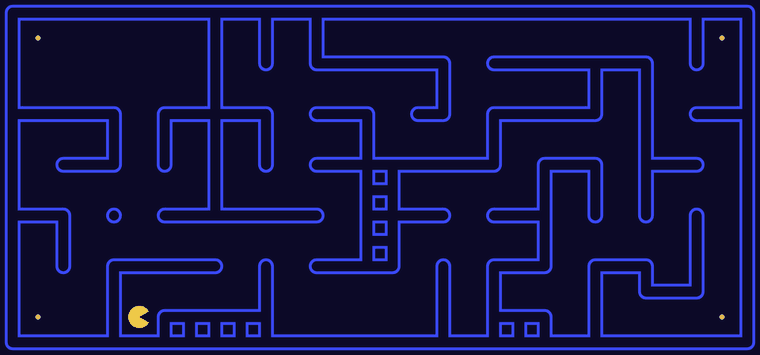
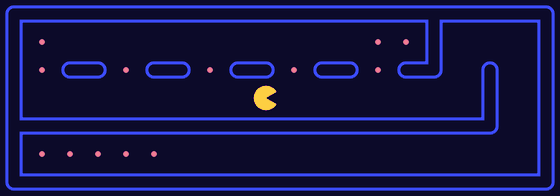
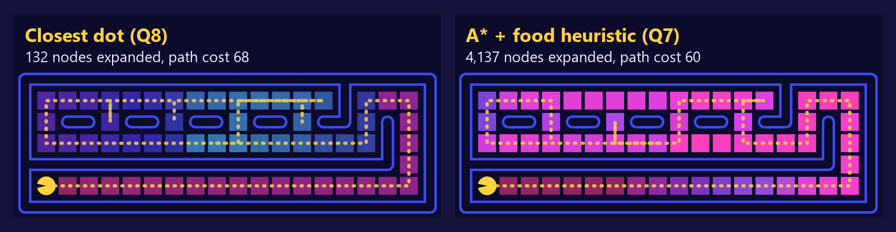
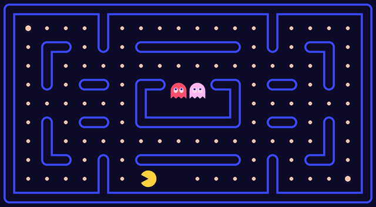
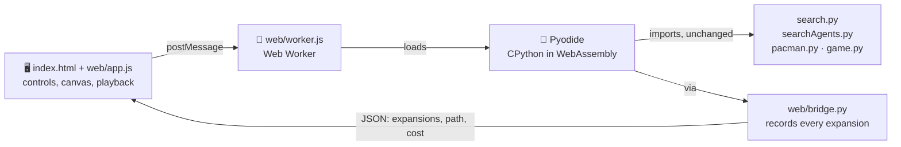

<div align="center">

# 🟡 Pac-Man Search Visualizer

**Watch DFS, BFS, UCS, A\* and greedy search think, one node at a time.**

Our SE3062 Intelligent Systems search code, running live in your browser 🧠✨

[](https://macromaster101.github.io/pacman-search-visualizer/)




<sub>Breadth-first search on <code>mediumMaze</code>: cyan cells were explored first, pink ones last. Then Pac-Man walks the 68-step shortest path. 🟡</sub>

</div>

---

## 🎮 Three ways to explore

| | Mode | What you do |
|---|------|-------------|
| 🔍 | **Visualize** | Pick a problem (find a dot, visit four corners, eat every dot), a maze and an algorithm. Watch every node get expanded, scrub the timeline, and read the exact Python function that ran. |
| ⚔️ | **Compare** | Run two algorithms side by side on the same maze and see which one expands fewer nodes and which finds the cheaper path. |
| 🕹️ | **Play** | Classic Pac-Man with the arrow keys (or W A S D, or the on-screen pad on a phone), using the real CS188 game rules and ghost AI. |

> 💡 Nothing is reimplemented in JavaScript. The page loads our actual `search.py` and `searchAgents.py` into [Pyodide](https://pyodide.org) (Python compiled to WebAssembly), so the numbers you see are the same ones the autograder checks.

## 🧭 Same maze, four algorithms



| Algorithm | Fringe | Nodes expanded | Path cost | Optimal? |
|-----------|--------|---------------:|----------:|:--------:|
| 🔻 **DFS** | `util.Stack` (last in, first out) | 146 | 130 | ❌ |
| 🌊 **BFS** | `util.Queue` (first in, first out) | 269 | 68 | ✅ when every step costs 1 |
| 💰 **UCS** | `util.PriorityQueue` by g(n) | 269 | 68 | ✅ |
| ⭐ **A\*** | `util.PriorityQueue` by g(n) + h(n) | **221** | 68 | ✅ with an admissible, consistent heuristic |

DFS expands the fewest nodes here, but it wanders: its path is almost twice as long. A\* gets the optimal path while skipping the parts of the maze the Manhattan heuristic says are pointless.

## 🏁 The harder problems

<table>
<tr>
<td width="56%" valign="top">

### 🧱 Visit all four corners (Q5, Q6)



The state is `(position, visitedCorners)`, a small hashable tuple. The heuristic is the shortest Manhattan tour through the corners that are left. Walls can only make the real tour longer, so it never overestimates.

**741 nodes** on `mediumCorners` (full marks needs ≤ 1200) 🎯

</td>
<td width="44%" valign="top">

### 🍒 Eat every dot (Q7)



The heuristic is the real maze distance to the farthest remaining dot. Pac-Man has to get there eventually, so it is admissible and consistent. Distances are cached, so the search stays fast.

**4,137 nodes** on `trickySearch` (full marks needs ≤ 9,000) 🚀

</td>
</tr>
</table>

### 🏃 Greedy vs optimal (Q8)



**Closest-dot search** runs a tiny BFS to the nearest dot, eats it, and repeats. It expands **31 times fewer nodes** than A\*, but its path is 8 steps longer, because always grabbing the nearest dot can leave a long trip back later. Try it yourself in **Compare** with the *Eat all the dots* problem. ⚖️

## 🕹️ And yes, you can just play it

<div align="center">

</div>

## ✅ Autograder results

| Q | Task | Who | Marks |
|---|------|-----|------:|
| Q1 | 🔻 Depth-first search | Chamara | 4 / 4 |
| Q2 | 🌊 Breadth-first search | Kavisha | 4 / 4 |
| Q3 | 💰 Uniform cost search | Sawanya | 4 / 4 |
| Q4 | ⭐ A\* search | Rosheni | 4 / 4 |
| Q5 | 🧱 Corners problem | Chamara | 8 / 8 |
| Q6 | 🧱 Corners heuristic (741 nodes) | Rosheni | 8 / 8 |
| Q7 | 🍒 Food heuristic (4,137 nodes) | Sawanya | 8 / 8 |
| | | **Assignment total** | **40 / 40** 🏆 |
| Q8 | 🏃 Closest-dot search *(extra, not part of the assignment)* | added for this site | ✅ 3 / 3 |

The full CS188 autograder (`python autograder.py`) scores **26 / 25**: every question passes, plus the Q7 bonus point for expanding fewer than 7,000 nodes. 🎉

## ⚙️ How it works



- 🧵 **Python runs in a Web Worker**, so a long search never freezes the page, and **Stop** can cut off a search that is taking too long.
- 📼 **`web/bridge.py`** wraps the problem's `getSuccessors` to record the order cells were expanded in. That is the cyan-to-pink heat map.
- 🎨 **`web/render.js`** draws the maze, heat map, Pac-Man and ghosts on a canvas. No frameworks, no build step.
- 🌐 Hosted on **GitHub Pages** straight from `main`. The first visit downloads Pyodide (about 10 MB); after that it is cached.

## 🚀 Run it yourself

**In the browser**, serve the folder and open http://localhost:8000:

```bash
python -m http.server 8000
```

**The original desktop version** (Python 3.9 to 3.11):

```bash
python pacman.py -l mediumMaze -p SearchAgent -a fn=bfs
python pacman.py -l mediumCorners -p AStarCornersAgent -z 0.5
python pacman.py -l trickySearch -p AStarFoodSearchAgent
```

**The autograder:**

```bash
python autograder.py          # everything
python autograder.py -q q2    # one question
```

## 🗂️ What's where

```
📁 pacman-search-visualizer
├── 🐍 search.py           ← DFS, BFS, UCS, A*        (Q1–Q4)
├── 🐍 searchAgents.py     ← corners, food, closest dot (Q5–Q8)
├── 🌐 index.html          ← the web app
├── 📁 web/
│   ├── app.js             ← modes, controls, playback
│   ├── render.js          ← canvas drawing
│   ├── worker.js          ← runs Pyodide off the main thread
│   ├── bridge.py          ← JSON bridge into the Python code
│   └── style.css
├── 📁 assets/             ← README images
├── 📁 layouts/            ← the mazes
└── 🐍 pacman.py, game.py, util.py, autograder.py …  (CS188 framework)
```

## 👥 Team

Built by **Chamara**, **Kavisha**, **Sawanya** and **Rosheni** for SE3062 Intelligent Systems, Faculty of Computing, 2026 💛

## 🙏 Attribution

The Pac-Man AI projects were developed at UC Berkeley: http://ai.berkeley.edu.
The core projects and autograders were primarily created by John DeNero and Dan Klein,
with student-side autograding by Brad Miller, Nick Hay and Pieter Abbeel.
The original licensing notice is kept at the top of every framework file.
